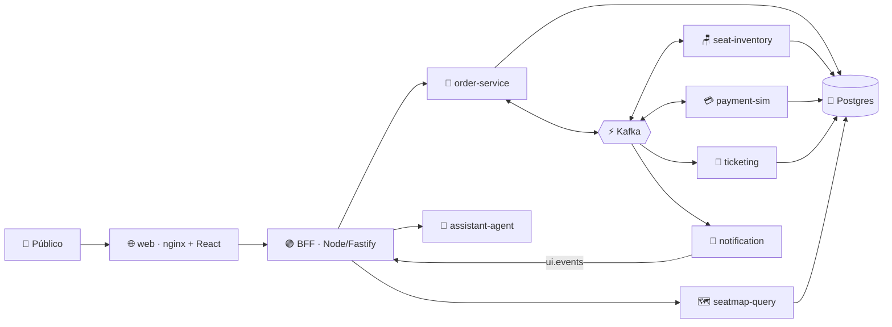

<div align="center">

# ⚡🎟️ SeatStorm

### Demo en vivo de arquitectura event-driven: vende 360 asientos de concierto a 200 personas a la vez, sin sobrevender ninguno.

[](https://quarkus.io)
[](https://kafka.apache.org)
[](https://nodejs.org)
[](https://react.dev)
[](https://python.org)
[](https://kubernetes.io)
[](https://www.dynatrace.com)

[🇬🇧 English](README.md) · 🇪🇸 **Español**

</div>

---

## ✨ ¿Qué es SeatStorm?

**SeatStorm** vende un concierto ficticio, **"Neon Tide · Arena Norte"**, con **360 asientos**. El público escanea un código QR 📱, elige un apodo y compra asientos desde su celular, mientras un presentador proyecta la **pantalla del escenario** 🎬 en vivo.

Por dentro muestra cómo **Kafka desacopla los microservicios** y cómo se comporta el sistema ante contención, expiración de reservas, caída de servicios, reintentos y escalado, con **cero sobreventa** 🛡️.

> 💡 Es una demo, no una arquitectura de producción: sin autenticación real, sin pagos reales y sin alta disponibilidad.

## 🧩 Arquitectura de un vistazo



| Pieza | Tecnología | Rol |
|---|---|---|
| 🌐 `web` | nginx + React 19 | App del público, pantalla del escenario y consola del presentador |
| 🟢 `bff` / `bot-swarm` | Node 22 + Fastify | Sesiones, SSE, bots de carga |
| 🧾 `order-service` | Quarkus (nativo) | Orquestador de la saga |
| 🪑 `seat-inventory` | Quarkus (nativo) | Servicio crítico: particiones por sección |
| 💳 `payment-sim` | Quarkus (nativo) | Pasarela simulada, se puede pausar en vivo |
| 🎫 `ticketing` · 🗺️ `seatmap-query` · 📣 `notification` · 🗂️ `event-catalog` | Quarkus (nativo) | Entradas, modelo de lectura CQRS, eventos de UI, catálogo |
| 🤖 `assistant-agent` | Python + FastAPI | Asistente de chat (Anthropic / NVIDIA) |
| ⚡ Plataforma | Kafka · Postgres · Apicurio · Kafka UI | Infraestructura compartida |

## 🚀 Inicio rápido

### Opción 1 — ☁️ GitHub Codespaces (la más rápida)

1. Haz clic en **Code ▸ Codespaces ▸ New codespace** (elige la máquina de **8 núcleos / 32 GB**; agrega `ANTHROPIC_API_KEY` o `NVIDIA_API_KEY` como secretos de Codespaces para el asistente de chat).
2. Cuando la terminal esté lista, ejecuta:

```bash
make codespaces-up         # 🔨 construye imágenes JVM + 🚀 levanta todo + 📱 imprime URL y QR
```

3. Abre el **puerto 8080** reenviado 🎉: app del público en `/`, escenario en `/stage` y consola del presentador en `/console` (PIN en `.env`, por defecto `4321`). Abre la venta desde la consola para empezar.

```bash
make codespaces-down       # 🛑 detener (con scripts/codespaces-down.sh --purge se borran los datos)
```

> ⏱️ La primera vez tarda unos minutos (Maven + construcción de imágenes); después el stack usa ~4 GB de RAM.

### Opción 2 — 💻 Local con Docker Compose

**Requisitos:** Docker 27+ con Compose v2 y `make` (GNU Make 3.82+).

```bash
cp .env.example .env
scripts/build-local-images.sh                                        # 🔨 imágenes JVM
docker compose -f compose.yaml -f compose.local.yaml --profile apps up -d
```

Abre **http://localhost:8080** 🎉. Cuando las imágenes estén publicadas en Docker Hub, `make demo-up` las descarga en lugar de construirlas.

### Opción 3 — ☸️ Kubernetes / Azure AKS

**Requisitos:** un clúster, `kubectl` apuntando a él y tus credenciales de Docker Hub.

```bash
cp .env.example .env                     # ✏️ completa los secretos
k8s/scripts/create-secrets.sh            # 🔐 crea los secretos y el pull secret de imágenes
make k8s-deploy TAG=<git-sha>            # 🚀 aplica el YAML de k8s/ e imprime la IP pública
```

¿Prefieres Helm?

```bash
make aks-deploy TAG=<git-sha>
```

> ⚠️ En un mismo clúster usa **Kustomize** (`k8s/`) **o** Helm (`charts/`), nunca ambos.

Para eliminar todo: `make k8s-destroy` 🧹

## 🗂️ Mapa del repositorio

```text
seatstorm/
├── 📜 contracts/       Eventos Avro + constantes del dominio
├── 🧰 platform-lib/    Outbox, inbox, relay, configuración común
├── ☕ services/        7 servicios Quarkus + assistant-agent (Python)
├── 🌐 web/             SPA (React), BFF, bots, nginx
├── ☸️ k8s/             YAML plano + Kustomize (base + overlays: aks, local)
├── ⛵ charts/          Charts de Helm (platform + seatstorm)
├── 🧪 tests/           k6 smoke/carga, e2e con Playwright
├── 🌱 seed/docs/       Conocimiento del asistente de chat
├── 📚 docs/            Decisiones, versiones, runbook
└── 📘 SEATSTORM-SPEC.md  Especificación completa
```

## 🎬 Escenas de la demo

1. 🪑 **Avalancha**: todos pelean por los mismos asientos
2. ⏳ **Expiración**: las reservas vencen y los asientos vuelven
3. 💥 **Pasarela caída**: pausa los pagos y mira crecer el lag
4. 🔁 **Recuperación**: se reanuda y el backlog se drena
5. 📈 **Escalado**: `kubectl scale deploy/seat-inventory --replicas=12`
6. 🤖 **Pregunta al asistente**: ¿por qué me quitaron mi asiento?

Guion completo y runbook: [`docs/RUNBOOK.md`](docs/RUNBOOK.md).

## 🛠️ Desarrollo

```bash
./mvnw -B verify            # ☕ compila y prueba todos los módulos Java
make dev SVC=seat-inventory # 🔥 un servicio en quarkus:dev (infra en Compose)
make test-web               # 🌐 pruebas de BFF, SPA y bots
make test-agent             # 🤖 pruebas del asistente
```

Las imágenes nativas se construyen en CI (cada una necesita 6–8 GB de RAM). 🏗️

## 📖 Más información

- 📘 [Especificación completa](SEATSTORM-SPEC.md) · 🧭 [Runbook](docs/RUNBOOK.md) · 📝 [Decisiones](docs/DECISIONS.md) · 🔢 [Versiones](docs/VERSIONS.md)

<div align="center">

Hecho con ☕ Quarkus, ⚡ Kafka y mucho 🎟️

</div>
