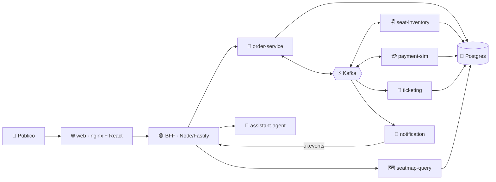

<div align="center">

# ⚡🎟️ SeatStorm

### Demo en vivo de arquitectura event-driven: vende 360 asientos de concierto a 200 personas a la vez, sin sobrevender ninguno.

[](https://quarkus.io)
[](https://kafka.apache.org)
[](https://nodejs.org)
[](https://react.dev)
[](https://python.org)
[](https://kubernetes.io)
[](https://www.dynatrace.com)

[🇬🇧 English](README.md) · 🇪🇸 **Español**

</div>

---

## ✨ ¿Qué es SeatStorm?

**SeatStorm** vende un concierto ficticio, **"Neon Tide · Arena Norte"**, con **360 asientos**. El público escanea un código QR 📱, elige un apodo y compra asientos desde su celular, mientras un presentador proyecta la **pantalla del escenario** 🎬 en vivo.

Por dentro muestra cómo **Kafka desacopla los microservicios** y cómo se comporta el sistema ante contención, expiración de reservas, caída de servicios, reintentos y escalado, con **cero sobreventa** 🛡️.

> 💡 Es una demo, no una arquitectura de producción: sin autenticación real, sin pagos reales y sin alta disponibilidad.

## 🧩 Arquitectura de un vistazo



| Pieza | Tecnología | Rol |
|---|---|---|
| 🌐 `web` | nginx + React 19 | App del público, pantalla del escenario y consola del presentador |
| 🟢 `bff` / `bot-swarm` | Node 22 + Fastify | Sesiones, SSE, bots de carga |
| 🧾 `order-service` | Quarkus (nativo) | Orquestador de la saga |
| 🪑 `seat-inventory` | Quarkus (nativo) | Servicio crítico: particiones por sección |
| 💳 `payment-sim` | Quarkus (nativo) | Pasarela simulada, se puede pausar en vivo |
| 🎫 `ticketing` · 🗺️ `seatmap-query` · 📣 `notification` · 🗂️ `event-catalog` | Quarkus (nativo) | Entradas, modelo de lectura CQRS, eventos de UI, catálogo |
| 🤖 `assistant-agent` | Python + FastAPI | Asistente de chat (Anthropic / NVIDIA) |
| ⚡ Plataforma | Kafka · Postgres · Apicurio · Kafka UI | Infraestructura compartida |

## 🚀 Inicio rápido

### Opción 1 — ☁️ GitHub Codespaces (la más rápida)

1. Haz clic en **Code ▸ Codespaces ▸ New codespace** (elige la máquina de **4 núcleos / 16 GB** (o mayor); agrega `ANTHROPIC_API_KEY` o `NVIDIA_API_KEY` como secretos de Codespaces para el asistente de chat; opcionalmente `DOCKER_ID` y `DOCKER_PAT`, tu usuario y personal access token de Docker Hub, para iniciar sesión en Docker Hub).
2. Cuando la terminal esté lista, ejecuta:

```bash
make codespaces-up         # 🔨 construye imágenes JVM + 🚀 levanta todo + 📱 imprime URL y QR
```

3. Abre el **puerto 8080** reenviado 🎉: app del público en `/`, escenario en `/stage` y consola del presentador en `/console` (PIN en `.env`, por defecto `4321`). Abre la venta desde la consola para empezar.

```bash
make codespaces-down       # 🛑 detener (con scripts/codespaces-down.sh --purge se borran los datos)
```

> ⏱️ La primera vez tarda unos minutos (Maven + construcción de imágenes); después el stack usa ~4 GB de RAM.

### Opción 2 — 💻 Local con Docker Compose

**Requisitos:** Docker 27+ con Compose v2 y `make` (cualquier versión, incluida la 3.81 que trae macOS).

```bash
cp .env.example .env
scripts/build-local-images.sh                                        # 🔨 imágenes JVM
docker compose -f compose.yaml -f compose.local.yaml --profile apps up -d
```

Abre **http://localhost:8080** 🎉. Cuando hayas subido imágenes a tu cuenta de Docker Hub (`make push-images`), define `DOCKER_ID` en `.env` y `make demo-up` descargará `docker.io/$DOCKER_ID/<servicio>:$TAG` en lugar de construirlas. Sin `DOCKER_ID` las imágenes se llaman `seatstorm/<servicio>` (solo construcción local).

### Opción 3 — ☸️ Kubernetes / Azure AKS (construir las imágenes y luego desplegar)

> 🎯 **Objetivo:** tus propias imágenes en **tu Docker Hub personal** (`docker.io/<DOCKER_ID>/<servicio>`) corriendo en un clúster AKS. Ejecuta los comandos en orden: cada script **pregunta lo que falte** (los tokens se escriben ocultos y nunca se guardan en disco).

#### 📋 Qué necesitas

| Necesitas | Detalle |
|---|---|
| 🐳 Docker | Corriendo en la máquina donde construyes (macOS: Docker Desktop o `colima start --cpu 4 --memory 8`). Las imágenes nativas necesitan **~8 GB de RAM para Docker** y una máquina **linux/amd64** (usa el Codespace); en Apple Silicon elige las imágenes **JVM**, que se compilan cruzadas para `linux/amd64` |
| 🔨 `make` | Cualquier versión (funciona con la 3.81 de macOS) |
| ☸️ `kubectl` + un clúster | Cualquier clúster Kubernetes; los pasos de abajo crean uno de AKS (necesita `az`) |
| 🔑 Docker Hub | Tu usuario (`DOCKER_ID`) y un access token (`DOCKER_PAT`, en hub.docker.com/settings/security; con permiso de **escritura** para publicar) |
| 📈 Dynatrace *(opcional)* | `DT_ENV_URL` (p. ej. `https://abc12345.live.dynatrace.com`) y `DT_API_TOKEN` (permiso `InstallerDownload`) para instrumentar los binarios nativos |
| 🤖 Clave LLM *(opcional)* | `NVIDIA_API_KEY` o `ANTHROPIC_API_KEY` para el asistente de chat |

#### 1️⃣ Crea el clúster (una vez)

```bash
az group create -n rg-seatstorm -l <region>
az aks create -g rg-seatstorm -n aks-seatstorm --node-count 3 --node-vm-size Standard_D4s_v5 --generate-ssh-keys
az aks get-credentials -g rg-seatstorm -n aks-seatstorm --admin     # apunta kubectl al clúster
kubectl get nodes                                                    # ✅ 3 nodos Ready
```

#### 2️⃣ Construye y publica las imágenes en Docker Hub

```bash
./scripts/build-push-dockerhub.sh       # 🧰 un solo script guiado: construye TODAS las imágenes que necesita AKS y las publica en tu Docker Hub
```

Pregunta, en este orden (exporta antes una variable para omitir su pregunta):

| Pregunta | Qué escribir |
|---|---|
| Tipo de imagen | **1** ⚡ nativa GraalVM *(recomendada: pequeña, arranca en ~0,1 s; ~4 min por servicio, ~8 GB de RAM para Docker, máquina linux/amd64 como el Codespace)* · **2** 🚀 JVM *(rápida de construir; despliega con `OVERLAY=aks-jvm`)* |
| Tag de la imagen | **Enter** para `latest`, o una versión como `v1.0.0` |
| `DOCKER_ID` | Tu usuario de Docker Hub |
| `DOCKER_PAT` *(oculto)* | Access token de Docker Hub con Read & Write |
| `DT_ENV_URL` *(solo nativas)* | Tu URL de Dynatrace, p. ej. `https://abc12345.live.dynatrace.com` — **Enter** para construir sin Dynatrace |
| `DT_API_TOKEN` *(oculto)* | Token de API de Dynatrace, permiso `InstallerDownload` (solo si diste la URL) |

Tras un resumen y una confirmación construye y publica las **11 imágenes** (7 servicios Quarkus + `bff`, `bot-swarm`, `web`, `assistant-agent`) como `docker.io/<DOCKER_ID>/<servicio>:<tag>` e imprime el siguiente comando.

```bash
scripts/build-push-dockerhub.sh --native --tag v1.0.0 --yes    # sin preguntas (exporta antes DOCKER_ID / DOCKER_PAT)
scripts/build-push-dockerhub.sh --jvm                          # imágenes JVM
scripts/build-push-dockerhub.sh --jvm --dry-run                # solo construye: sin login, no publica nada (valida el build)
PLATFORMS=linux/arm64 scripts/build-push-dockerhub.sh --jvm    # nodos arm64 (por defecto: linux/amd64, lo que usa AKS)
```

Avanzado (mismo motor): `make push-native [SVC=seat-inventory] [NATIVE_XMX=3g]`, `make push-images` (JVM), `DRY_RUN=1 scripts/push-native.sh notification` (solo construye, no publica). Alternativa en CI: sube a GitHub y ejecuta el workflow **release** (secretos del repo `DOCKER_ID`, `DOCKER_PAT`, y opcionales `DT_ENV_URL`, `DT_API_TOKEN`). Alternativa en CI: sube a GitHub y ejecuta el workflow **release** (secretos del repo `DOCKER_ID`, `DOCKER_PAT`, y opcionales `DT_ENV_URL`, `DT_API_TOKEN`).

#### 3️⃣ Despliega en AKS

```bash
make k8s-deploy                      # tag "latest" por defecto; o: make k8s-deploy TAG=v1.0.0
# ¿Imágenes JVM?  OVERLAY=aks-jvm make k8s-deploy
```

Comprueba `kubectl`, muestra el clúster destino y pide confirmación; luego pregunta lo que falte:

| Pregunta | Notas |
|---|---|
| `DOCKER_ID` / `DOCKER_PAT` *(oculto)* | **Obligatorias.** Crean el secreto `dockerhub` para descargar imágenes (basta un token de solo lectura) |
| `ANTHROPIC_API_KEY` / `NVIDIA_API_KEY` | Opcionales. Sin clave el asistente responde con un texto de respaldo. Modelo NVIDIA por defecto: `openai/gpt-oss-20b` |
| `CONSOLE_PIN` | PIN de la consola del presentador (propone uno aleatorio) |
| `DB_PASSWORD`, `ADMIN_TOKEN`, `SESSION_SECRET`, `TICKET_SECRET` | Se generan solos; en redespliegues se reutilizan los del clúster |

Puedes precargar todas las variables con `source k8s/scripts/setup-env.sh`. Sin interacción (CI): expórtalas y ejecuta `ASSUME_YES=1 k8s/scripts/deploy.sh <tag>`.

#### 4️⃣ Ábrelo 🎉

Al terminar imprime la URL pública (`http://<IP-EXTERNA>`):

| Página | Ruta |
|---|---|
| 📱 Público | `/` |
| 🎬 Pantalla del escenario | `/stage` |
| 🎛️ Consola del presentador (PIN) | `/console` — abre la venta desde aquí para empezar |

```bash
kubectl get pods -n seatstorm            # todos Running
kubectl get svc web -n seatstorm         # EXTERNAL-IP
kubectl logs deploy/seat-inventory -n seatstorm --tail=50
```

#### 🩹 Problemas frecuentes

| Síntoma | Solución |
|---|---|
| `ImagePullBackOff` | Verifica que las imágenes existen (`docker.io/<DOCKER_ID>/<servicio>:<tag>`) y que `DOCKER_PAT` es válido; vuelve a desplegar |
| Pods `OOMKilled` | Publicaste imágenes JVM pero desplegaste el overlay nativo → `OVERLAY=aks-jvm make k8s-deploy` |
| Build nativo muerto / muy lento | Da a Docker ≥ 8 GB (`NATIVE_XMX=3g`) y construye en linux/amd64 (el Codespace) |
| Web con `EXTERNAL-IP <pending>` | Espera ~2 min al balanceador de carga de Azure |
| Redespliegue con `latest` muestra código viejo | `make k8s-deploy` ya fuerza `imagePullPolicy: Always` y un rollout restart |

> 💡 Para una demo reproducible despliega una versión fija (`TAG=v1.0.0`) en lugar de `latest`.
> ⚠️ En un mismo clúster usa **Kustomize** (`make k8s-deploy`) **o** Helm (`make aks-deploy`), nunca ambos.

🧹 Para eliminar todo: `make k8s-destroy`

## 🗂️ Mapa del repositorio

```text
seatstorm/
├── 📜 contracts/       Eventos Avro + constantes del dominio
├── 🧰 platform-lib/    Outbox, inbox, relay, configuración común
├── ☕ services/        7 servicios Quarkus + assistant-agent (Python)
├── 🌐 web/             SPA (React), BFF, bots, nginx
├── ☸️ k8s/             YAML plano + Kustomize (base + overlays: aks, local)
├── ⛵ charts/          Charts de Helm (platform + seatstorm)
├── 🧪 tests/           k6 smoke/carga, e2e con Playwright
├── 🌱 seed/docs/       Conocimiento del asistente de chat
├── 📚 docs/            Decisiones, versiones, runbook
└── 📘 SEATSTORM-SPEC.md  Especificación completa
```

## 🎬 Escenas de la demo

1. 🪑 **Avalancha**: todos pelean por los mismos asientos
2. ⏳ **Expiración**: las reservas vencen y los asientos vuelven
3. 💥 **Pasarela caída**: pausa los pagos y mira crecer el lag
4. 🔁 **Recuperación**: se reanuda y el backlog se drena
5. 📈 **Escalado**: `kubectl scale deploy/seat-inventory --replicas=12`
6. 🤖 **Pregunta al asistente**: ¿por qué me quitaron mi asiento?

Guion completo y runbook: [`docs/RUNBOOK.md`](docs/RUNBOOK.md).

## 🛠️ Desarrollo

```bash
./mvnw -B verify            # ☕ compila y prueba todos los módulos Java
make dev SVC=seat-inventory # 🔥 un servicio en quarkus:dev (infra en Compose)
make test-web               # 🌐 pruebas de BFF, SPA y bots
make test-agent             # 🤖 pruebas del asistente
```

Las imágenes nativas se construyen en CI (cada una necesita 6–8 GB de RAM). 🏗️

## 📖 Más información

- 📘 [Especificación completa](SEATSTORM-SPEC.md) · 🧭 [Runbook](docs/RUNBOOK.md) · 📝 [Decisiones](docs/DECISIONS.md) · 🔢 [Versiones](docs/VERSIONS.md)

<div align="center">

Hecho con ☕ Quarkus, ⚡ Kafka y mucho 🎟️

</div>
