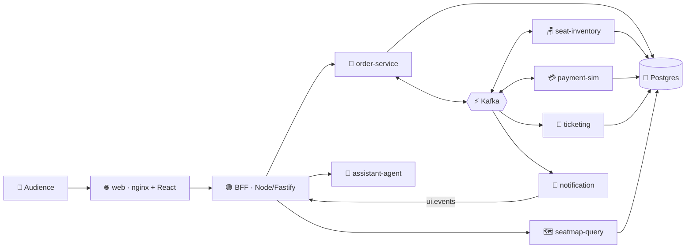

<div align="center">

# ⚡🎟️ SeatStorm

### Live event-driven demo: sell 360 concert seats to 200 people at once — without ever overselling one.

[](https://quarkus.io)
[](https://kafka.apache.org)
[](https://nodejs.org)
[](https://react.dev)
[](https://python.org)
[](https://kubernetes.io)
[](https://www.dynatrace.com)

🇬🇧 **English** · [🇪🇸 Español](README.es.md)

</div>

---

## ✨ What is SeatStorm?

**SeatStorm** sells a fictional concert, **"Neon Tide · Arena Norte"**, with **360 seats**. The audience scans a 📱 QR code, picks a nickname and buys seats from their phone, while a presenter projects the live **stage screen** 🎬.

Behind the scenes it showcases how **Kafka decouples microservices** and how the system behaves under contention, hold expiration, service outages, retries and scale-out — with **zero overselling** 🛡️.

> 💡 It's a demo, not a production architecture: no real auth, no real payments, no HA.

## 🧩 Architecture at a glance



| Piece | Tech | Role |
|---|---|---|
| 🌐 `web` | nginx + React 19 | Audience app, stage screen and presenter console |
| 🟢 `bff` / `bot-swarm` | Node 22 + Fastify | Sessions, SSE, load bots |
| 🧾 `order-service` | Quarkus (native) | Saga orchestrator |
| 🪑 `seat-inventory` | Quarkus (native) | Critical service: per-section partitions |
| 💳 `payment-sim` | Quarkus (native) | Simulated gateway, can be paused live |
| 🎫 `ticketing` · 🗺️ `seatmap-query` · 📣 `notification` · 🗂️ `event-catalog` | Quarkus (native) | Tickets, CQRS read model, UI events, catalog |
| 🤖 `assistant-agent` | Python + FastAPI | Chat assistant (Anthropic / NVIDIA) |
| ⚡ Platform | Kafka · Postgres · Apicurio · Kafka UI | Shared infrastructure |

## 🚀 Quick start

### Option 1 — ☁️ GitHub Codespaces (fastest)

1. Click **Code ▸ Codespaces ▸ New codespace** (pick the **4-core / 16 GB** (or larger) machine; add `ANTHROPIC_API_KEY` or `NVIDIA_API_KEY` as Codespaces secrets for the chat assistant).
2. When the terminal is ready, run:

```bash
make codespaces-up         # 🔨 builds JVM images + 🚀 starts everything + 📱 prints URL and QR
```

3. Open the forwarded **port 8080** 🎉 — audience app at `/`, stage at `/stage`, presenter console at `/console` (PIN in `.env`, default `4321`). Open the sale from the console to start.

```bash
make codespaces-down       # 🛑 stop (add --purge via scripts/codespaces-down.sh --purge to wipe data)
```

> ⏱️ First run takes a few minutes (Maven + image builds); the stack then needs ~4 GB of RAM.

### Option 2 — 💻 Local with Docker Compose

**Requirements:** Docker 27+ with Compose v2, `make` (GNU Make 3.82+).

```bash
cp .env.example .env
scripts/build-local-images.sh                                        # 🔨 JVM images
docker compose -f compose.yaml -f compose.local.yaml --profile apps up -d
```

Then open **http://localhost:8080** 🎉. Once images are published to Docker Hub, `make demo-up` pulls them instead of building.

### Option 3 — ☸️ Kubernetes / Azure AKS

**Requirements:** a cluster, `kubectl` pointing at it, and your Docker Hub credentials.

```bash
cp .env.example .env                     # ✏️ fill in the secrets
k8s/scripts/create-secrets.sh            # 🔐 creates secrets + image pull secret
make k8s-deploy TAG=<git-sha>            # 🚀 applies the YAML in k8s/ and prints the public IP
```

Prefer Helm? 

```bash
make aks-deploy TAG=<git-sha>
```

> ⚠️ Use **either** Kustomize (`k8s/`) **or** Helm (`charts/`) on a given cluster, never both.

Remove everything: `make k8s-destroy` 🧹

## 🗂️ Repository map

```text
seatstorm/
├── 📜 contracts/       Avro events + shared domain constants
├── 🧰 platform-lib/    Outbox, inbox, relay, common config
├── ☕ services/        7 Quarkus services + Python assistant-agent
├── 🌐 web/             SPA (React), BFF, bots, nginx
├── ☸️ k8s/             Plain YAML + Kustomize (base + overlays: aks, local)
├── ⛵ charts/          Helm charts (platform + seatstorm)
├── 🧪 tests/           k6 smoke/load, Playwright e2e
├── 🌱 seed/docs/       Knowledge used by the chat assistant
├── 📚 docs/            Decisions, versions, runbook
└── 📘 SEATSTORM-SPEC.md  Full specification
```

## 🎬 Demo scenes

1. 🪑 **Rush** — everyone fights for the same seats
2. ⏳ **Expiration** — holds time out and seats return
3. 💥 **Gateway down** — pause payments, watch the lag grow
4. 🔁 **Recovery** — resume, the backlog drains
5. 📈 **Scale-out** — `kubectl scale deploy/seat-inventory --replicas=12`
6. 🤖 **Ask the assistant** — why was my seat taken?

Full script and runbook: [`docs/RUNBOOK.md`](docs/RUNBOOK.md).

## 🛠️ Development

```bash
./mvnw -B verify            # ☕ build + test all Java modules
make dev SVC=seat-inventory # 🔥 one service in quarkus:dev (infra in Compose)
make test-web               # 🌐 BFF, SPA and bots tests
make test-agent             # 🤖 assistant tests
```

Native images are built in CI (they need 6–8 GB of RAM each). 🏗️

## 📖 Learn more

- 📘 [Full specification](SEATSTORM-SPEC.md) · 🧭 [Runbook](docs/RUNBOOK.md) · 📝 [Decisions](docs/DECISIONS.md) · 🔢 [Versions](docs/VERSIONS.md)

<div align="center">

Made with ☕ Quarkus, ⚡ Kafka and a lot of 🎟️

</div>
