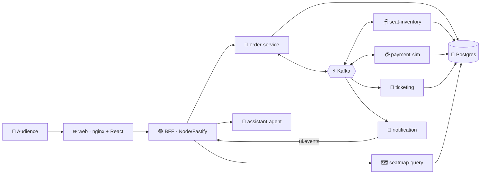

<div align="center">

# ⚡🎟️ SeatStorm

### Live event-driven demo: sell 360 concert seats to 200 people at once — without ever overselling one.

[](https://quarkus.io)
[](https://kafka.apache.org)
[](https://nodejs.org)
[](https://react.dev)
[](https://python.org)
[](https://kubernetes.io)
[](https://www.dynatrace.com)

🇬🇧 **English** · [🇪🇸 Español](README.es.md)

</div>

---

## ✨ What is SeatStorm?

**SeatStorm** sells a fictional concert, **"Neon Tide · Arena Norte"**, with **360 seats**. The audience scans a 📱 QR code, picks a nickname and buys seats from their phone, while a presenter projects the live **stage screen** 🎬.

Behind the scenes it showcases how **Kafka decouples microservices** and how the system behaves under contention, hold expiration, service outages, retries and scale-out — with **zero overselling** 🛡️.

> 💡 It's a demo, not a production architecture: no real auth, no real payments, no HA.

## 🧩 Architecture at a glance



| Piece | Tech | Role |
|---|---|---|
| 🌐 `web` | nginx + React 19 | Audience app, stage screen and presenter console |
| 🟢 `bff` / `bot-swarm` | Node 22 + Fastify | Sessions, SSE, load bots |
| 🧾 `order-service` | Quarkus (native) | Saga orchestrator |
| 🪑 `seat-inventory` | Quarkus (native) | Critical service: per-section partitions |
| 💳 `payment-sim` | Quarkus (native) | Simulated gateway, can be paused live |
| 🎫 `ticketing` · 🗺️ `seatmap-query` · 📣 `notification` · 🗂️ `event-catalog` | Quarkus (native) | Tickets, CQRS read model, UI events, catalog |
| 🤖 `assistant-agent` | Python + FastAPI | Chat assistant (Anthropic / NVIDIA) |
| ⚡ Platform | Kafka · Postgres · Apicurio · Kafka UI | Shared infrastructure |

## 🚀 Quick start

### Option 1 — ☁️ GitHub Codespaces (fastest)

1. Click **Code ▸ Codespaces ▸ New codespace** (pick the **4-core / 16 GB** (or larger) machine; add `ANTHROPIC_API_KEY` or `NVIDIA_API_KEY` as Codespaces secrets for the chat assistant; optionally `DOCKER_ID` and `DOCKER_PAT` (Docker Hub username and personal access token) to log in to Docker Hub).
2. When the terminal is ready, run:

```bash
make codespaces-up         # 🔨 builds JVM images + 🚀 starts everything + 📱 prints URL and QR
```

3. Open the forwarded **port 8080** 🎉 — audience app at `/`, stage at `/stage`, presenter console at `/console` (PIN in `.env`, default `4321`). Open the sale from the console to start.

```bash
make codespaces-down       # 🛑 stop (add --purge via scripts/codespaces-down.sh --purge to wipe data)
```

> ⏱️ First run takes a few minutes (Maven + image builds); the stack then needs ~4 GB of RAM.

### Option 2 — 💻 Local with Docker Compose

**Requirements:** Docker 27+ with Compose v2, `make` (any version, including the 3.81 that ships with macOS).

```bash
cp .env.example .env
scripts/build-local-images.sh                                        # 🔨 JVM images
docker compose -f compose.yaml -f compose.local.yaml --profile apps up -d
```

Then open **http://localhost:8080** 🎉. Once you have pushed images to your Docker Hub account (`make push-images`), set `DOCKER_ID` in `.env` and `make demo-up` pulls `docker.io/$DOCKER_ID/<service>:$TAG` instead of building. Without `DOCKER_ID` the images are named `seatstorm/<service>` (local builds only).

### Option 3 — ☸️ Kubernetes / Azure AKS (build the images, then deploy)

> 🎯 **Goal:** your own images in **your personal Docker Hub** (`docker.io/<DOCKER_ID>/<service>`) running on an AKS cluster. Just run the commands in order — every script **asks for whatever is missing** (tokens are typed hidden and never written to disk).

#### 📋 What you need

| Need | Details |
|---|---|
| 🐳 Docker | Running on the machine where you build (macOS: Docker Desktop or `colima start --cpu 4 --memory 8`). Native images need **~8 GB RAM for Docker** and a **linux/amd64** machine (use the Codespace); on Apple Silicon choose **JVM** images, which are cross-built for `linux/amd64` |
| 🔨 `make` | Any version (the macOS default 3.81 works) |
| ☸️ `kubectl` + a cluster | Any Kubernetes cluster; the steps below create an AKS one (needs `az`) |
| 🔑 Docker Hub | Your username (`DOCKER_ID`) and an access token (`DOCKER_PAT`, from hub.docker.com/settings/security; **write** access to push) |
| 📈 Dynatrace *(optional)* | `DT_ENV_URL` (e.g. `https://abc12345.live.dynatrace.com`) and `DT_API_TOKEN` (scope `InstallerDownload`) to instrument the native binaries |
| 🤖 LLM key *(optional)* | `NVIDIA_API_KEY` or `ANTHROPIC_API_KEY` for the chat assistant |

#### 1️⃣ Create the cluster (once)

```bash
az group create -n rg-seatstorm -l <region>
az aks create -g rg-seatstorm -n aks-seatstorm --node-count 3 --node-vm-size Standard_D4s_v5 --generate-ssh-keys
az aks get-credentials -g rg-seatstorm -n aks-seatstorm --admin     # points kubectl at the cluster
kubectl get nodes                                                    # ✅ 3 nodes Ready
```

#### 2️⃣ Build and push the images to Docker Hub

```bash
./scripts/build-push-dockerhub.sh       # 🧰 one guided script: builds ALL the images AKS needs and pushes them to your Docker Hub
```

It asks, in this order (export a variable beforehand to skip its question):

| Prompt | What to enter |
|---|---|
| Image type | **1** ⚡ native GraalVM *(recommended: tiny, starts in ~0.1 s; ~4 min per service, ~8 GB RAM for Docker, linux/amd64 machine such as the Codespace)* · **2** 🚀 JVM *(fast to build; deploy with `OVERLAY=aks-jvm`)* |
| Services | **1** all 11 *(default)* · **2** service by service (a `Build <service>? [Y/n]` question for each: `event-catalog`, `order-service`, `seat-inventory`, `payment-sim`, `ticketing`, `seatmap-query`, `notification`, `assistant-agent`, `bff`, `bot-swarm`, `web`) |
| Image tag | **Enter** for `latest`, or a version like `v1.0.0` |
| `DOCKER_ID` | Your Docker Hub username |
| `DOCKER_PAT` *(hidden)* | Docker Hub access token with Read & Write |
| `DT_ENV_URL` *(native only)* | Your Dynatrace URL, e.g. `https://abc12345.live.dynatrace.com` — **Enter** to build without Dynatrace |
| `DT_API_TOKEN` *(hidden)* | Dynatrace API token, scope `InstallerDownload` (only if you gave the URL) |

After a summary and a confirmation it builds and pushes the **selected images** (by default the **11**: 7 Quarkus services + `bff`, `bot-swarm`, `web`, `assistant-agent`) as `docker.io/<DOCKER_ID>/<service>:<tag>`, and prints the next command. Rebuilt only one service? Redeploy it with `kubectl rollout restart deploy/<service> -n seatstorm`.

```bash
scripts/build-push-dockerhub.sh --native --tag v1.0.0 --yes    # no questions (export DOCKER_ID / DOCKER_PAT first)
scripts/build-push-dockerhub.sh --jvm                          # JVM images
scripts/build-push-dockerhub.sh --jvm --dry-run                # build only: no login, nothing is pushed (validates the build)
scripts/build-push-dockerhub.sh --native --services order-service,bff   # only these services (no question)
scripts/build-push-dockerhub.sh --all                          # all 11 services (no question)
PLATFORMS=linux/arm64 scripts/build-push-dockerhub.sh --jvm    # arm64 nodes (default: linux/amd64, what AKS uses)
```

Advanced (same engine): `make push-native [SVC=seat-inventory] [NATIVE_XMX=3g]`, `make push-images` (JVM), `DRY_RUN=1 scripts/push-native.sh notification` (build only, push nothing). CI alternative: push to GitHub and run the **release** workflow (repo secrets `DOCKER_ID`, `DOCKER_PAT`, optional `DT_ENV_URL`, `DT_API_TOKEN`).

#### 3️⃣ Deploy to AKS

```bash
make k8s-deploy                      # tag "latest" by default; or: make k8s-deploy TAG=v1.0.0
# JVM images?  OVERLAY=aks-jvm make k8s-deploy
```

It checks `kubectl`, shows the target cluster and asks for confirmation, then asks for what is missing:

| Prompt | Notes |
|---|---|
| `DOCKER_ID` / `DOCKER_PAT` *(hidden)* | **Required.** Creates the `dockerhub` image-pull secret (a read-only token is enough) |
| `ANTHROPIC_API_KEY` / `NVIDIA_API_KEY` | Optional. Without a key the assistant answers with a fallback text. NVIDIA default model: `openai/gpt-oss-20b` |
| `CONSOLE_PIN` | Presenter console PIN (a random one is proposed) |
| `DB_PASSWORD`, `ADMIN_TOKEN`, `SESSION_SECRET`, `TICKET_SECRET` | Generated automatically; reused from the cluster on redeploys |

You can pre-load every variable with `source k8s/scripts/setup-env.sh`. Non-interactive (CI): export them and run `ASSUME_YES=1 k8s/scripts/deploy.sh <tag>`.

#### 4️⃣ Open it 🎉

When the script ends it prints the public URL (`http://<EXTERNAL-IP>`):

| Page | Path |
|---|---|
| 📱 Audience | `/` |
| 🎬 Stage screen | `/stage` |
| 🎛️ Presenter console (PIN) | `/console` — open the sale from here to start |

```bash
kubectl get pods -n seatstorm            # all Running
kubectl get svc web -n seatstorm         # EXTERNAL-IP
kubectl logs deploy/seat-inventory -n seatstorm --tail=50
```

#### 🩹 Troubleshooting

| Symptom | Fix |
|---|---|
| `ImagePullBackOff` | Check the images exist (`docker.io/<DOCKER_ID>/<service>:<tag>`) and that `DOCKER_PAT` is valid; redeploy |
| Pods `OOMKilled` | You pushed JVM images but deployed the native overlay → `OVERLAY=aks-jvm make k8s-deploy` |
| Native build killed / very slow | Give Docker ≥ 8 GB (`NATIVE_XMX=3g`), build on linux/amd64 (the Codespace) |
| Web shows `EXTERNAL-IP <pending>` | Wait ~2 min for the Azure load balancer |
| Redeploy with `latest` shows old code | `make k8s-deploy` already forces `imagePullPolicy: Always` + a rollout restart |
| Chat answers "Estoy tardando más de lo normal" | The model took too long for the first text token (`kubectl logs deploy/assistant-agent -n seatstorm -c assistant-agent \| grep provider_error` shows `no first token`). Reasoning models (NVIDIA `openai/gpt-oss-20b`) think before answering. Raise `LLM_FIRST_TOKEN_TIMEOUT_S` (default in the manifests: 30) or set a faster, non-reasoning `NVIDIA_MODEL`. Quick test: `kubectl set env deploy/assistant-agent -n seatstorm LLM_FIRST_TOKEN_TIMEOUT_S=60` |
| Chat answers "Ahora mismo no puedo responder con la IA" | No provider/key match or a provider error (401 key, 404 model, 429 rate limit). Check `kubectl exec deploy/assistant-agent -n seatstorm -c assistant-agent -- sh -c 'echo $LLM_PROVIDER'` and the same logs. Giving only `NVIDIA_API_KEY` selects `nvidia` automatically |

> 💡 For a reproducible demo, deploy a fixed version (`TAG=v1.0.0`) instead of `latest`.
> ⚠️ Use **either** Kustomize (`make k8s-deploy`) **or** Helm (`make aks-deploy`) on a given cluster, never both.
> 📈 **Dynatrace in the cluster:** the deploy does not ask for Dynatrace data. Install the **Dynatrace Operator + DynaKube** *before* deploying (or `kubectl rollout restart deploy -n seatstorm` afterwards); it injects the connection details into the native binaries built with `DT_ENV_URL` / `DT_API_TOKEN`.
> 🤖 **Chat assistant:** if you only give `NVIDIA_API_KEY`, the deploy selects the `nvidia` provider automatically (stored as `LLM_PROVIDER` in the `seatstorm-secrets` secret).

🧹 Remove SeatStorm from the cluster: `make k8s-destroy` (deletes the `seatstorm` and `seatstorm-platform` namespaces, which holds every resource, secret and volume, and warns about orphan disks). It targets the **current `kubectl` context**, so it shows it before asking for confirmation. The AKS cluster itself keeps running and **billing**; to remove it too: `az group delete -n rg-seatstorm --yes --no-wait`. The Dynatrace Operator, if you installed it, is not touched.

## 🗂️ Repository map

```text
seatstorm/
├── 📜 contracts/       Avro events + shared domain constants
├── 🧰 platform-lib/    Outbox, inbox, relay, common config
├── ☕ services/        7 Quarkus services + Python assistant-agent
├── 🌐 web/             SPA (React), BFF, bots, nginx
├── ☸️ k8s/             Plain YAML + Kustomize (base + overlays: aks, local)
├── ⛵ charts/          Helm charts (platform + seatstorm)
├── 🧪 tests/           k6 smoke/load, Playwright e2e
├── 🌱 seed/docs/       Knowledge used by the chat assistant
├── 📚 docs/            Decisions, versions, runbook
└── 📘 SEATSTORM-SPEC.md  Full specification
```

## 🎬 Demo scenes

1. 🪑 **Rush** — everyone fights for the same seats
2. ⏳ **Expiration** — holds time out and seats return
3. 💥 **Gateway down** — pause payments, watch the lag grow
4. 🔁 **Recovery** — resume, the backlog drains
5. 📈 **Scale-out** — `kubectl scale deploy/seat-inventory --replicas=12`
6. 🤖 **Ask the assistant** — why was my seat taken?

Full script and runbook: [`docs/RUNBOOK.md`](docs/RUNBOOK.md).

## 🛠️ Development

```bash
./mvnw -B verify            # ☕ build + test all Java modules
make dev SVC=seat-inventory # 🔥 one service in quarkus:dev (infra in Compose)
make test-web               # 🌐 BFF, SPA and bots tests
make test-agent             # 🤖 assistant tests
```

Native images are built in CI (they need 6–8 GB of RAM each). 🏗️

## 📖 Learn more

- 📘 [Full specification](SEATSTORM-SPEC.md) · 🧭 [Runbook](docs/RUNBOOK.md) · 📝 [Decisions](docs/DECISIONS.md) · 🔢 [Versions](docs/VERSIONS.md)

<div align="center">

Made with ☕ Quarkus, ⚡ Kafka and a lot of 🎟️

</div>
